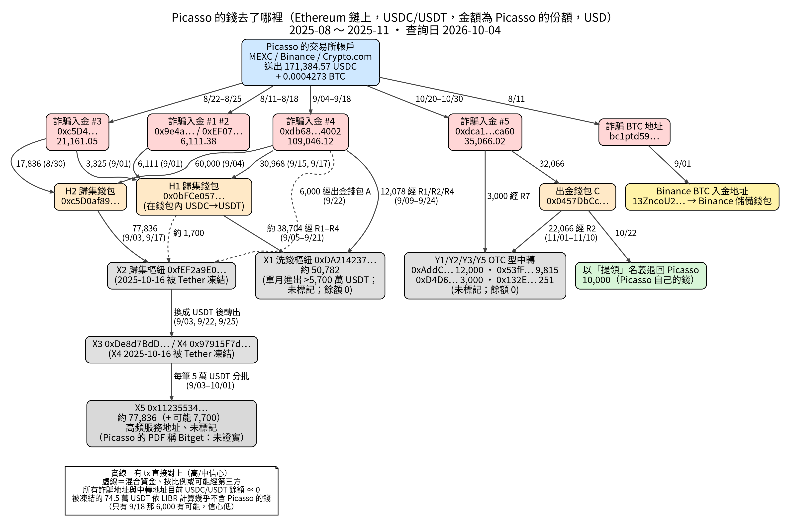

# GoldEx on-chain fund trace

Open reconstruction of where funds deposited into the fake trading platform **GoldEx / ggoldex.org** (pig-butchering / fake binary-options scam, Aug–Nov 2025) moved on-chain.

The victim is referred to as **Picasso** (pseudonym). This repository contains **only the on-chain analysis**. It does **not** include bank statements, tax documents, chat screenshots, or other personal evidence.

Query date: **2026-10-04** (Europe/Oslo).

## Key findings (short)

- **11 USDC deposits on Ethereum** + **1 BTC** deposit → about **171,384.57 USDC** and **0.0004273 BTC** received on-chain.
- About **26,598.79** was paid back as fake “withdrawals” (mostly other victims’ money; **10,000** of one payout was Picasso’s own deposit returned).
- **Net on-chain loss ≈ 144,786 USDC-equivalent.**
- Main sinks of Picasso’s share:
  - **X1** [`0xDA214237…Af0a`](https://etherscan.io/address/0xDA2142378e6dB3423965C14dE6F5D0876c69Af0a) ≈ **50,782 USDT** (large unlabeled laundering hub; balance 0)
  - **X5** [`0x11235534…D1C9`](https://etherscan.io/address/0x11235534a66A33c366b84933D5202c841539D1C9) ≈ **77,836 USDT** (high-volume unlabeled address that calls Bitget Wallet Swap Bridge; **still holds ~441,977 USDT**, not frozen)
  - **Y-series OTC-like wallets** ≈ **25,066** (then dispersed; balances 0)
  - **BTC** swept into a Binance deposit address
- Tether froze related hubs **X2/X4** on **2025-10-16**; ~**745,434 USDT** remains frozen, but almost none of Picasso’s attributed share sits in that frozen balance under a lowest-intermediate-balance attribution.

Full narrative (Traditional Chinese): [`docs/trace_report.md`](docs/trace_report.md)

Flow diagram:



## Repo layout

```
docs/trace_report.md   Full report (zh-TW), every claim backed by a tx hash
data/hops.csv          118 hops: from, to, token, amount, time, tx, chain, label, confidence
data/hops.json         Same hops as structured JSON
data/balances.json     Snapshot of balances checked on the query date
assets/flow_diagram.png
assets/flow.dot        Graphviz source for the diagram
scripts/               Ad-hoc Python used to fetch Blockscout data and build hops.csv
```

## Method (brief)

1. Start from Picasso’s deposit tx hashes into five scam deposit addresses (+ one BTC address).
2. Follow USDC/USDT token transfers hop by hop (FIFO / proportional split when funds are pooled).
3. Stop at large unlabeled hubs or labeled entities; do not invent further attribution.
4. Cross-check Tether freeze timing and current balances.
5. Verify claims from earlier Arkham-style PDFs against raw chain data.

Public sources used: Blockscout / Etherscan-compatible APIs, mempool.space (BTC). Arkham pages were Cloudflare-blocked during the run, so no Arkham labels were relied on.

## Reproduce / extend

Scripts under `scripts/` are research helpers (not a polished package). Paths inside them may need adjusting. Typical flow:

```bash
# example: rebuild hops.csv from the curated hop list in scripts/build.py
# (requires network access to Blockscout)
python scripts/build.py
```

To redraw the diagram from Graphviz:

```bash
dot -Tpng assets/flow.dot -o assets/flow_diagram.png
```

## What this is not

- Not legal advice.
- Not a claim that any labeled exchange knowingly held Picasso’s funds.
- Not a full OSINT package (no WhatsApp chats, KYC, or bank trails).

## License

Documentation and data: [CC BY 4.0](LICENSE).  
Scripts: MIT (same LICENSE file covers both, see notice inside).
